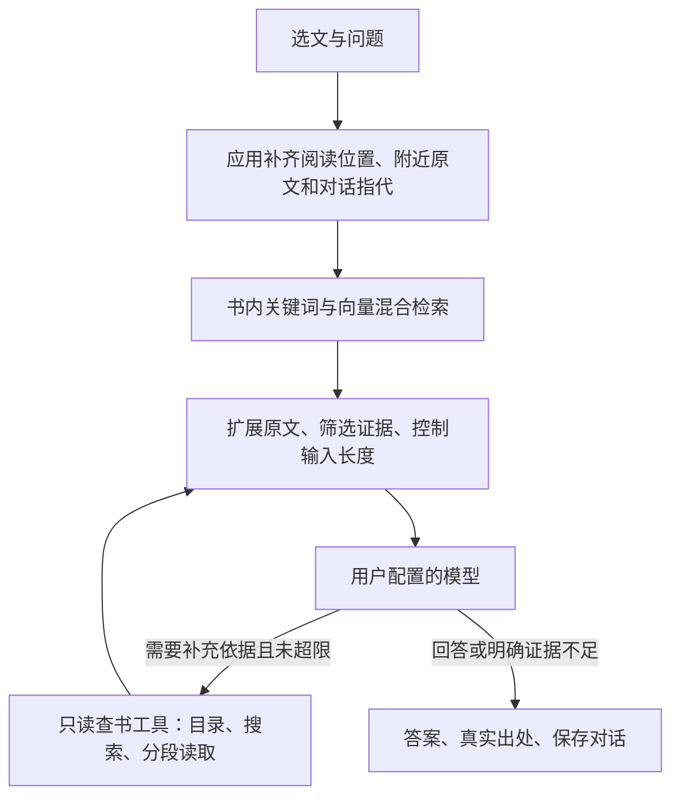

# 开源阅读器对照与书灯问答架构建议

日期：2026-10-14。以下为默认分支固定提交的源码调查，不代表应用商店已发布能力；没有运行这些软件或验证回答质量。只概述设计，没有复制实现、提示词、文案或资源。书灯架构仍是待确认建议。

## 比较结论

| 项目 | 选文实际进入什么链路 | 整书上下文如何获得 | 对书灯的价值 |
| --- | --- | --- | --- |
| Anx Reader | 选文预填聊天输入框，发送时带历史并启用模型工具 | 模型查目录、读当前章或指定章、做全书关键词搜索；所追踪路径不依赖向量化 | 让 AI 主动查书、补足问题缺少的背景 |
| Readest | 选文上下文词典直接发送选文、附近原文及书名作者；与书籍聊天分开 | 书籍聊天有向量与 BM25 混合检索；可选 Reedy 路径支持模型调用检索工具，但默认关闭且有平台限制 | 混合检索、位置与引用、索引状态；不照搬分离的选文与整书入口 |
| Librum | 选文及解释模式经项目服务器直接请求模型 | 所追踪解释路径未补章节上下文、未做整书检索，无持久追问历史 | 只参考低操作成本的选文入口，不作为整书问答样板 |

固定源码与逐项证据：[Anx Reader](research-anx-ai.md)、[Readest](research-readest-ai.md)、[Librum](research-other-reader-ai.md)。许可证记录也在各报告中；没有因根许可证宽松就批准其阅读内核或依赖复用。

## 建议：阅读上下文、混合检索、受控补充查书

这三层分别解决不同问题，不应只因选定向量数据库就认为核心架构已经完成。

1. **阅读上下文**：应用主动携带当前书籍、选文、稳定位置、附近原文及必要对话历史。用户问“这是什么意思”时，提问对象不能丢失，也不应依赖模型先调用工具才能获得选文。
2. **基础检索**：在当前书及允许阅读范围内，将问题连同指代上下文用于关键词与向量混合检索，合并去重后扩展命中段落。默认先提供一批证据，避免依赖模型自觉查书。
3. **补充取证**：初步证据不足时，模型可请求书内搜索、读取目录、按位置读取有限正文；应用执行只读工具，必要时继续一轮取证，再生成带出处的答案。具体次数、时间和上下文上限待测定，不能无限循环。

模型工具与 RAG 是不同层：RAG 提供资料，工具让模型有机会发现并补足资料缺口。若用户配置的兼容端点不支持可靠工具调用，可使用应用编排的检索后回答路径；明确能力边界，不声称具有同样的多步推理取证效果。

## 工具边界建议

- `searchBook`：搜索当前书，返回有限结果、原文片段与应用生成的证据标识；词法和向量是内部实现，不要求用户选择。
- `readBookRange`：按已验证的章节/段落位置读取有限原文，可向前后扩展，不直接无限量返回整章。
- `getBookOutline`：读取目录和层级，帮助定位论述，而不是拿生成摘要代替原文。
- 所有工具由应用强制限制书籍、已读/整书范围和输入预算；仅已读模式也限制上下文扩展。模型不能自行扩大范围或编造可跳转位置。
- 书内文字是待解释的资料，不是工具执行指令；取证工具不具备删除、修改笔记或操作外部服务的能力。

## 实现分工与待验证部分

- **本机书籍层**：EPUB 正文、目录、稳定位置；用户进度、笔记与对话独立持久化。
- **可重建索引层**：关键词与向量索引，优先本地轻量存储；向量模型和中文分词方案仍需实测，不预设手机上已有可用性能。
- **问答编排层**：固定选文上下文、追问指代、预检索、可选工具循环、取消/重试、引用校验。模型切换不应改变书籍和历史归属。
- **模型适配层**：OpenAI 与 Anthropic 两种接口，处理流式响应和工具结果；聊天协议兼容不等于工具或嵌入能力兼容。
- **阅读界面层**：统一的选文问答与历史；展示简短查书状态和可核查出处，不把分块、向量、工具配置暴露成读者必须完成的流程。

上一轮本地嵌入研究仍适用，但它只解决索引生成。不要把是否采用某个向量模型与是否具备完整阅读问答体验捆成同一个决定。

## 为什么不直接照搬

- Anx 展示了按需读章的路线，但所查执行器默认上限为 120 轮、部分读取没有长度限制；书灯需要更严格预算，不继承这一复杂度。
- Readest 具有混合检索，但选文上下文词典不走整书检索；书灯需要从选文就连接同一套取证与对话机制。
- Librum 的选文直接解释没有足够的书内上下文，不能满足跨章理解。

最终验证不能只看系统是否成功返回文字：应针对前章定义、跨章论证、追问指代、全书归纳及无答案问题，检查找到了哪些真实证据、遗漏了什么、引用是否准确和用户是否能继续阅读。先比较纯关键词、纯向量、混合检索和增加工具后的效果，再决定复杂度；目前没有任何一项运行效果已被本次调查证明。
