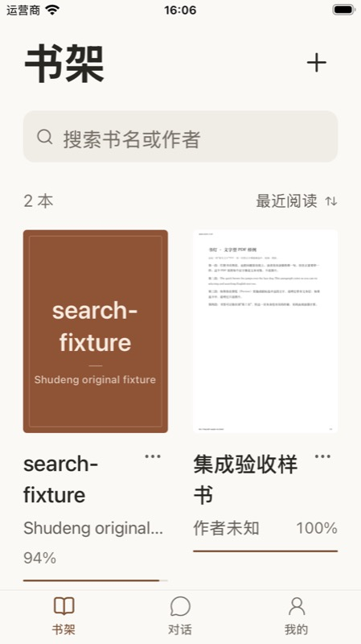

# 高亮与笔记归入每本书

日期：2026-11-07。任务：[GitHub #58](https://github.com/andyWang1688/shudeng/issues/58)。源码：`codex/ui-product-integration` 工作区，包含此前 UI 接线和缺陷修复，尚未提交或发布。产品决定见 [ADR-0021](../../adr/0021-book-owned-annotations.md)。

## 本轮交付

底部导航保留书架、对话、我的；移除独立笔记页及无消费者的跨书标注聚合函数。EPUB/PDF 目录弹层增加标注分栏，书架书籍菜单提供“查看标注”捷径，复用同一单书组件。保留高亮颜色、笔记正文、位置排序、全量搜索、行内展开、左滑编辑与确认删除、单书导出及回到原文。书签仍独立管理，历史数据与存储 schema 不变。

单书快捷入口不依赖原文件即可读取、编辑和导出；缺少文件或定位信息时，仅阻止回到原文并提示原因。旧全局界面代码已删除，用户书籍、数据库、偏好及旧 Swift App 数据未清理。

独立复审发现阅读路由的旧读取可能覆盖刚保存的标注，以及旧书回调可能污染新书。增加读取版本与书籍所有权校验；新增回归先出现两项失败，修复后 3/3 通过。

## 源码检查

移动端完整检查 Node **421/421**、Vitest **183/183**，共 **604 项通过**；移动端 typecheck 与 `git diff --check` 通过。最后仅将书内弹层标题改为书名，避免长功能标题截断；改后再次执行相关 EPUB/PDF 弹层与导航回归 **21/21**、typecheck 和差异检查通过。

回归覆盖单书过滤与全量导出、保存/删除失败、关闭期间拒绝新操作、已接受写入继续同步、路由失焦/切书与迟到读取、原文件缺失及无定位记录。受控时序测试不等同于真实设备全部行为通过。

## Small 实际操作

目标为 Shudeng Small，iPhone SE 第三代、iOS 26.5，独立开发包 `dev.shudeng.integration`（书灯·开发）。复用现有 Release 原生构建，更新 JS/资产后重新签名安装；最终标题修改也已安装并打开核对。更新中遇到模拟器关机，启动同一 Small 后安装成功。未替换正式包或原生对照包。

仅使用开发沙盒内既有 EPUB/PDF 验收夹具，没有读取密钥或发送模型请求。

| 输入与操作 | 实际结果 |
| --- | --- |
| 打开书架，再从 PDF 书籍省略号选择查看标注 | 底栏只有三项；弹层标题为该书书名，显示该书 6 条记录。 |
| 搜索 `20261107`，再清空 | 仅保留匹配笔记，清空恢复 6 条。 |
| 左滑 1 秒打开编辑/删除；编辑笔记后取消 | 操作按钮可用，取消后回到列表。 |
| 将笔记正文 `20261107` 改为 `2026110707`，保存并重开 | 新正文保留；验收结束前已恢复为 `20261107` 并保存。 |
| 删除高亮，取消确认 | 原记录仍保留；未在设备执行永久删除。 |
| 导出后取消系统分享 | 打开文本分享面板，文件 411 字节；取消后解除忙碌状态，未发往外部。 |
| 点击 PDF 标注 1 | 打开同一本 PDF 第 1 页；随后恢复原第 2 页进度。 |
| 打开 PDF 目录，切标注、展开全屏、关闭重开 | 页面、书签、标注分栏正常；同书重开保留标注分栏。最终更新再次核对全屏书名与三分栏。 |
| 打开 EPUB，进入目录的标注分栏 | 正确显示没有标注，没有混入 PDF 记录。 |

最终已返回书架。键盘捕获保持原设置；没有修改系统设置。

## 验证边界与已知限制

本次包包含[前五轮缺陷修复](ui-bug-review.md)，但没有在本轮逐项重做全部设备用例。EPUB 非空标注回跳、原文件缺失/已移除书籍入口及永久删除本轮仅有源码回归，未在设备重新执行。软件键盘遮挡、短促左滑、动画帧率、大字体、完整 VoiceOver、Android、真实模型与联网均未验证。

组件卸载后已接受写入仍会完成并重新读取单书记录；如果此时重读失败，会记录错误，完整重开阅读器或快捷入口时重新加载。仅重开同一个书内面板的失败恢复尚未实测。此记录不表示所有 BUG 已消除或已正式发布。

后续第六轮复查发现此整书重读还可能覆盖同书较新的编辑，已由[缺陷复查](ui-bug-review.md#同日第六轮复查)中的按 ID 合并更新与读取失效保护取代，不再使用关闭后整书重读同步。

任务临时部署副本由 trap 回收；收尾只清理本轮脚本、日志及截图原件，保留本页证据、正式源码、开发沙盒数据和可复用原生构建。
